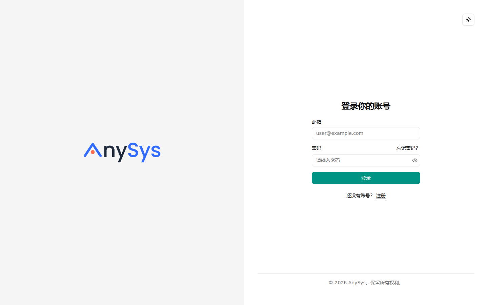
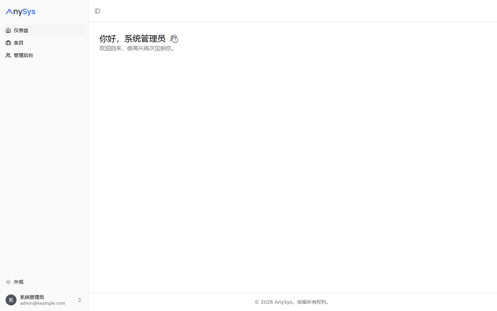
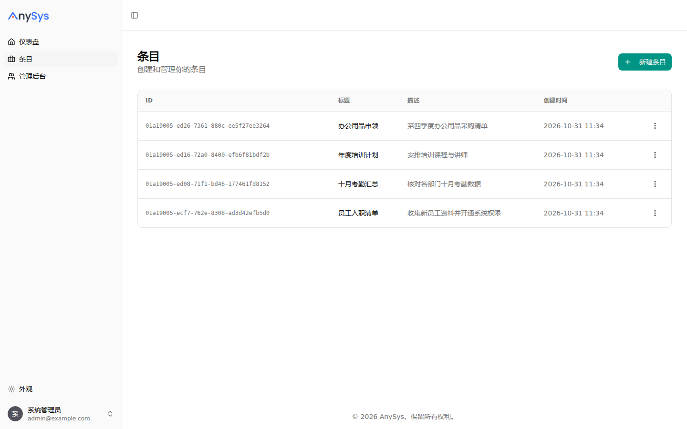
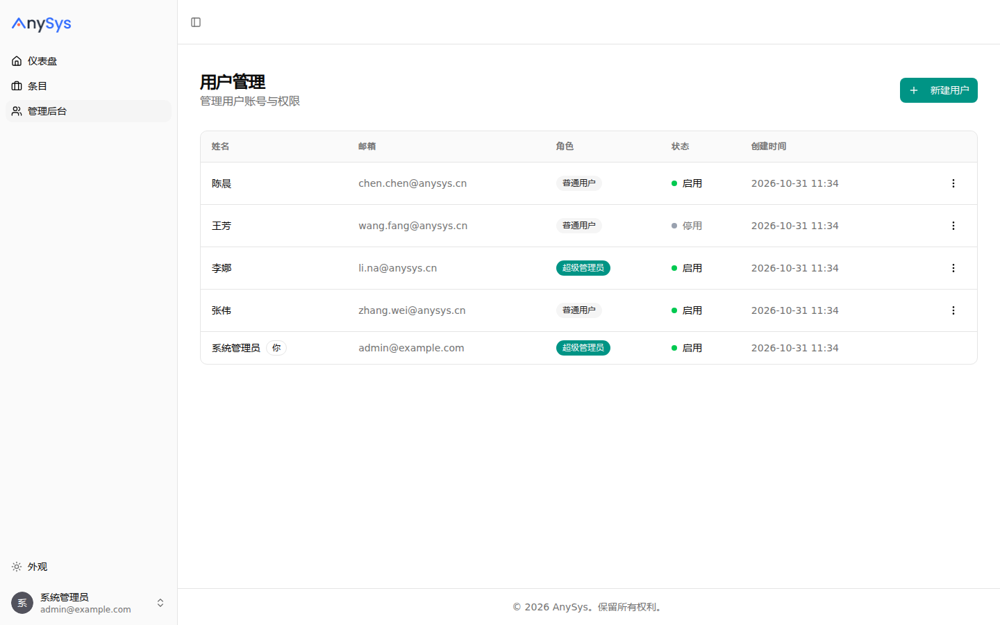

# AnySys

AnySys is a full-stack web application with a React frontend and a FastAPI backend. The interface is in Simplified Chinese, and the frontend is built into the backend and served on the same domain as the API.

## Technology Stack and Features

- ⚡ [**FastAPI**](https://fastapi.tiangolo.com) for the Python backend API.
  - 🧰 [SQLModel](https://sqlmodel.tiangolo.com) for the Python SQL database interactions (ORM).
  - 🔍 [Pydantic](https://docs.pydantic.dev), used by FastAPI, for the data validation and settings management.
  - 💾 [PostgreSQL](https://www.postgresql.org) as the SQL database.
- 🚀 [React](https://react.dev) for the frontend.
  - 🧩 Built into the backend application and served by FastAPI on the same domain as the API.
  - 💃 Using TypeScript, hooks, [Vite](https://vitejs.dev), and other parts of a modern frontend stack.
  - 🎨 [Tailwind CSS](https://tailwindcss.com) and [shadcn/ui](https://ui.shadcn.com) for the frontend components.
  - 🤖 An automatically generated frontend client.
  - 🧪 [Playwright](https://playwright.dev) for end-to-end testing.
  - 🦇 Dark mode support.
- 🐋 [Docker Compose](https://www.docker.com) for local services and self-hosted deployment.
  - 📞 [Traefik](https://traefik.io) as a reverse proxy with automatic HTTPS.
- 🔒 Secure password hashing by default.
- 🔑 JWT (JSON Web Token) authentication.
- 📫 Email-based password recovery.
- ✉️ [React Email](https://react.email) for email templates.
- 📬 [Mailpit](https://mailpit.axllent.org) for local email testing during development.
- ✅ Tests with [Pytest](https://pytest.org).
- 🏭 CI (continuous integration) based on GitHub Actions.

## Screenshots

### Login

### Dashboard

### Items

### Admin

## Getting Started

- Development guide: [development.md](./development.md)
- Backend guide: [backend/README.md](./backend/README.md)
- Frontend guide: [frontend/README.md](./frontend/README.md)
- Deployment guide: [deployment-docker-compose.md](./deployment-docker-compose.md). Docker Compose is the only supported deployment path.

Historical documents from the upstream project are archived in [docs/upstream/](./docs/upstream/) and are not part of the AnySys documentation.

## License

AnySys is licensed under the terms of the MIT license.
